# OMNI-Train, step by step

OMNI-Train fine-tunes Hugging Face models (LLMs, vision, detection, VLMs, encoders) on one GPU or many. This guide follows a single run from `bash scripts/launch.sh` to the saved checkpoint. Each step shows the file it lives in and the PyTorch idea behind it.

The same guide is available as an [HTML page](omni-train-field-guide.html) and a [PDF](omni-train-field-guide.pdf).

**Diagram colours:** blue = model / weights · amber = memory / shards · green = trained on · red = masked / ignored

## Contents

1. [The whole run on one page](#01-the-whole-run-on-one-page)
2. [launch.sh and torchrun](#02-launchsh-and-torchrun)
3. [Config and utils.py](#03-config-and-utilspy)
4. [getattr, and why it's everywhere](#04-getattr-and-why-its-everywhere)
5. [solo, DDP or FSDP](#05-solo-ddp-or-fsdp)
6. [How DDP works](#06-how-ddp-works)
7. [How FSDP2 works](#07-how-fsdp2-works)
8. [Meta-device initialization](#08-meta-device-initialization)
9. [RoPE and non-persistent buffers](#09-rope-and-non-persistent-buffers)
10. [tie_word_embeddings](#10-tie_word_embeddings)
11. [Precision, autocast and mixed precision](#11-precision-autocast-and-mixed-precision)
12. [PEFT and LoRA](#12-peft-and-lora)
13. [Quantization (bitsandbytes)](#13-quantization-bitsandbytes)
14. [Data, padding and labels](#14-data-padding-and-labels)
15. [The training step](#15-the-training-step)
16. [The Checkpointer](#16-the-checkpointer)
17. [Web UI and job queue](#17-web-ui-and-job-queue)
18. [dist_kit: the portable core](#18-dist_kit-the-portable-core)
19. [Glossary](#19-glossary)

---

## 01. The whole run on one page

*train.py · utils.py · distributed_utils.py · data.py · checkpoint.py*

Every run follows the same eight steps. The rest of this guide zooms into each one.

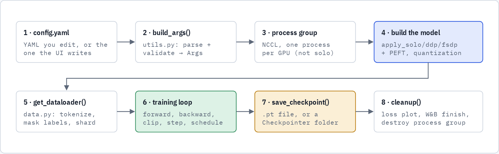

Steps 3 and 4 depend on `strategy`. Steps 4 to 6 also depend on `model_type`, which chooses the Hugging Face class, the data pipeline and the arguments passed to the model.

| model_type | Hugging Face class | Batch it receives |
|---|---|---|
| `llm` | `AutoModelForCausalLM` | input_ids, attention_mask, labels |
| `seq2seq` | `AutoModelForSeq2SeqLM` | input_ids, attention_mask, labels |
| `encoder` | `AutoModel` | input_ids, attention_mask, labels |
| `vision` | `AutoModelForImageClassification` | pixel_values, labels |
| `yolo` | `AutoModelForObjectDetection` | pixel_values, list of box dicts |
| `vlm` | `AutoModelForImageTextToText` | input_ids, pixel_values, labels, … |
| `custom_transformer` | `model.Transformer` (toy) | random tokens, next-token loss |

---

## 02. launch.sh and torchrun

*scripts/launch.sh · distributed_utils.setup_dist_process_group()*

`launch.sh` reads `strategy` and `num_gpus` from the config. Either one can be overridden from the environment, as in `STRATEGY=ddp NUM_GPUS=2`. For `solo` it runs plain `python train.py`. For `ddp` and `fsdp` it hands off to `torchrun`, which starts one copy of `train.py` per GPU.

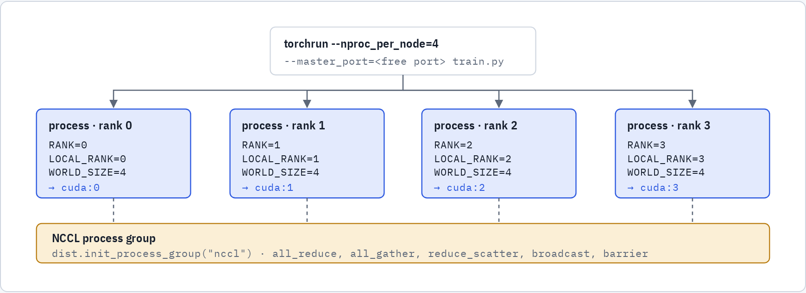

torchrun sets these environment variables before Python starts. `setup_dist_process_group()` reads `LOCAL_RANK`, calls `torch.cuda.set_device()` and joins the group. Rank 0 does the printing, downloading and saving; the other ranks wait at barriers.

- **RANK** is a process's global id across every machine. **LOCAL_RANK** is its index on this machine, which picks its GPU. **WORLD_SIZE** is the total number of processes.
- **NCCL_P2P_DISABLE** is set automatically. If NVML reports no NVLink, peer-to-peer transfer is turned off, because NCCL's PCIe topology probe can hang on cards like the RTX A4000.
- Runs started from the UI or the job queue get a **free master port** from `find_free_port()`, so two jobs can run at once without fighting over port 29500.
- A **barrier** is a point every rank must reach before any continues. `dist_barrier()` passes `device_ids=[local_rank]` for NCCL.

---

## 03. Config and utils.py

*utils.load_config() · utils.build_args() · utils.estimate_training_vram/time()*

`load_config()` reads `$CONFIG_PATH` (default `config.yaml`). `build_args()` flattens the nested YAML into an `Args` object, for example `peft.r` becomes `args.peft_r`. It also rejects bad combinations before any GPU work starts.

```yaml
training:
  epochs: 4
  batch_size: 8
  max_length: 64
  learning_rate: 2e-5
  warmup_steps: 10
  lr_scheduler: cosine        # cosine | linear | constant
strategy: fsdp                # solo | ddp | fsdp
dist_parameters:
  mixed_precision: true
  param_dtype: bfloat16       # compute dtype; weights stay fp32
peft:          { enabled: false, type: lora, r: 8, alpha: 16 }
quantization: { enabled: false, bits: 8 }
```

**Rules build_args enforces**

| Combination | Result | Why |
|---|---|---|
| `strategy: fsdp` + quantization | error | FSDP can't shard bitsandbytes' packed integer weights |
| 4-bit quantization, no PEFT | error | NF4 weights have no gradient; something else has to learn |
| 8-bit quantization, no PEFT | warning | only norms and biases can learn; NaN losses are likely |
| `peft.type: qlora` | turns on PEFT and quantization | QLoRA is LoRA on a quantized base |
| unknown `lr_scheduler` | error | must be cosine, linear or constant |

utils.py also holds the helpers that estimate VRAM and training time, the terminal loss plot (`plotext`) and `dist_barrier()`. The web UI and the terminal both call the same estimator, so their numbers agree.

---

## 04. getattr, and why it's everywhere

*distributed_utils.py · dist_kit/strategies.py*

`getattr(obj, "name", default)` is Python's way to read an attribute when the name is a string, with a fallback value if it doesn't exist. The codebase uses it in four ways:

1. **Defensive config reads.** Helpers accept an `Args`, a `DistConfig` or a test's `SimpleNamespace`. Each may lack a field, and a fallback keeps them working.
2. **Walking dotted paths.** `get_model_layers()` follows strings like `"model.decoder.layers"` one `getattr` at a time to find the transformer blocks to shard.
3. **Finding a buffer's owner.** `_restore_buffers()` turns `"model.rotary_emb.inv_freq"` into the parent module plus the name `"inv_freq"`, then calls `setattr` on it.
4. **Optional features.** `getattr(processor, "image_processor", None)` lets one code path handle processors that do or don't have a component.

```python
# 1 · fallback when a field is missing
peft_enabled = getattr(args, "peft_enabled", False)

# 2 · walk "model.decoder.layers" → model.model.decoder.layers
target = model
for part in path.split("."):
    if not hasattr(target, part): ok = False; break
    target = getattr(target, part)

# 3 · "model.rotary_emb.inv_freq" → parent module, then setattr
*path, attr = name.split(".")
parent = model
for part in path:
    parent = getattr(parent, part)
setattr(parent, attr, snapshot[name].to(device))
```

---

## 05. solo, DDP or FSDP

*distributed_utils.apply_solo() · apply_ddp() · apply_fsdp()*

Full fine-tuning with AdamW stores about 16 bytes per parameter: 4 for the fp32 weight, 4 for its gradient and 8 for Adam's two moment estimates. For a 1-billion-parameter model that is 16 GB before activations. The strategy decides where those 16 GB live.

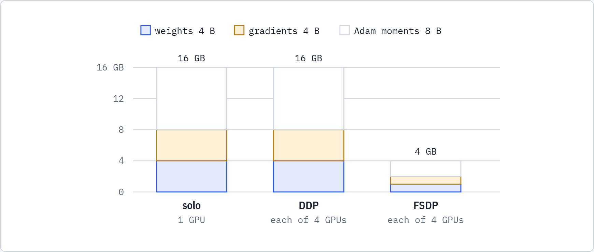

Drawn to scale for a 1B-parameter model trained in fp32 with AdamW, activations excluded. DDP copies everything to every GPU, so it buys speed, not memory. FSDP splits all three across the GPUs, so per-GPU memory drops by the number of GPUs.

| Strategy | Use it when | Launch | Works with quantization |
|---|---|---|---|
| **solo** | one GPU | `python train.py` | yes |
| **DDP** | the model fits on one GPU and you want more throughput | `torchrun` | yes |
| **FSDP** | the model doesn't fit on one GPU | `torchrun` | no |

---

## 06. How DDP works

*torch.nn.parallel.DistributedDataParallel · apply_ddp()*

Every GPU holds the whole model and gets a different slice of each batch from the `DistributedSampler`. After `backward()`, DDP **all-reduces** the gradients so every GPU holds the average. Each GPU then runs the same optimizer step on the same averaged gradient, so the copies stay identical.

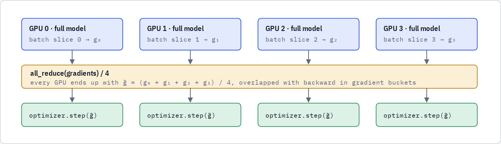

In `apply_ddp()`, rank 0 downloads the weights into the HF cache first while the others wait at a barrier, then every rank loads from that cache. The model is wrapped with `DDP(model, device_ids=[local_rank])`.

---

## 07. How FSDP2 works

*torch.distributed.fsdp.fully_shard · get_model_layers() · set_modules_to_forward/backward_prefetch()*

FSDP2's `fully_shard(module)` turns each parameter into a **DTensor** split along dimension 0, so each rank keeps 1/N of every weight. OMNI-Train calls it on every transformer block, then on the root model. A full layer only exists for the moment it is being computed:

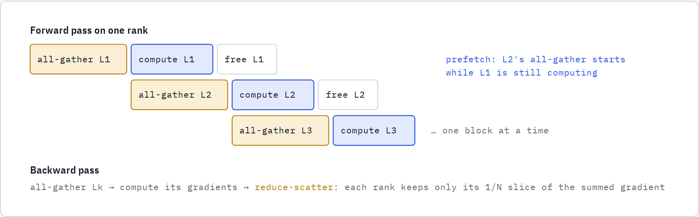

Explicit prefetching (`prefetch.forward: 2`, `prefetch.backward: 2`) tells each block which blocks to gather next, so communication overlaps with compute. `get_model_layers()` finds the blocks: first from HF's `_no_split_modules`, then a list of known paths, then the largest `ModuleList`.

FSDP has three loading paths, chosen in `apply_fsdp()`:

| Path | When | How the weights arrive |
|---|---|---|
| 1 · custom transformer | `model_type: custom_transformer` | build on meta, shard, `to_empty()`, `reset_parameters()` |
| 2 · PEFT | `peft.enabled: true` | full model loaded on CPU, adapters attached, then sharded layer by layer |
| 3 · meta init | everything else | build on meta, shard, then load: resume, fresh HF seed or random (next step) |

---

## 08. Meta-device initialization

*distributed_utils._apply_fsdp_meta_init() · _snapshot_buffers() · _restore_buffers() · _remove_seed_dir()*

A tensor on the **meta device** has a shape and a dtype but no memory behind it. Building a 70B model on meta costs almost nothing, so no single rank ever has to hold the full model. FSDP then decides which slice each rank owns, and each rank allocates only that slice.

1. **Build with parameters on meta.** `accelerate.init_empty_weights(include_buffers=False)` puts parameters on meta but computes buffers for real, so RoPE's `inv_freq` gets its exact Hugging Face value.
2. **Shard.** `fully_shard()` on each block, then the root, with a `MixedPrecisionPolicy` when mixed precision is on.
3. **Snapshot the buffers.** `_snapshot_buffers()` copies them, because the next step wipes everything.
4. **Allocate.** `model.to_empty(device="cuda")` gives each rank real but uninitialized memory for its own slice.
5. **Load the weights.** **A, resume:** the `Checkpointer` reads the checkpoint at `resume_path`. **B, fresh run:** rank 0 downloads the model, saves a timestamped seed `.pt`, and all ranks load exactly that seed. **C, random:** `init_weights()`.
6. **Restore the buffers.** `_restore_buffers()` writes the snapshot back into the non-persistent buffers, the ones `state_dict()` never contains.
7. **Delete the seed.** After a barrier, rank 0 removes only this run's seed folder, so a concurrent run's seed is left alone.

```python
with init_empty_weights(include_buffers=False):
    model = AutoModelForCausalLM.from_config(config, dtype=torch.float32)
for layers, _ in get_model_layers(model):
    for layer in layers:
        fully_shard(layer, mp_policy=mp)
fully_shard(model, mp_policy=mp)

buffers = _snapshot_buffers(model)       # inv_freq, position_ids, …
model.to_empty(device=device)            # this rank's slice, uninitialized
checkpointer.load_model(model)           # rank 0 reads; NCCL broadcasts slices
_restore_buffers(model, buffers, device, rank)
```

---

## 09. RoPE and non-persistent buffers

*_snapshot_buffers() · _restore_buffers() · tests/test_fsdp_buffers.py*

**RoPE** (rotary position embedding) encodes position by rotating pairs of query and key dimensions. Pair *i* rotates at angular speed `inv_freq[i] = θ^(−2i/d)`. Fast pairs track nearby tokens and slow pairs track distant ones. The base θ (`rope_theta`) and any rope scaling come from the model's config.

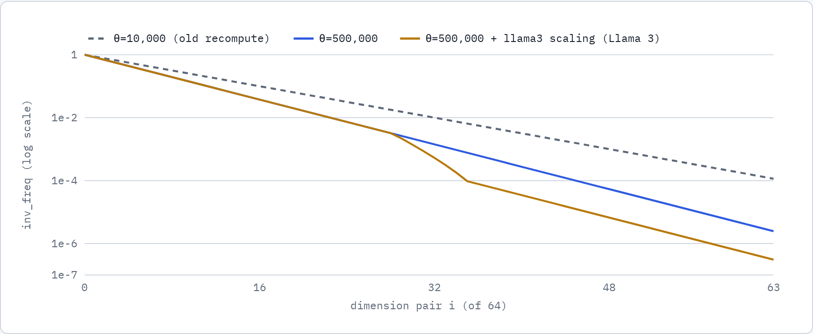

Computed with head dimension 128. The dashed line is what the old code produced for every model: the textbook θ = 10,000. Llama 3 actually uses θ = 500,000 plus llama3 scaling, which slows the low-frequency pairs by a further 8×. Using the wrong curve breaks positional information without raising any error.

**Why the buffer has to be restored.** `inv_freq` is registered with `persistent=False`, so it is not part of `state_dict()` and no checkpoint ever contains it. `to_empty()` overwrites it with uninitialized memory, and nothing reloads it. BERT's `position_ids` have the same problem. The fix is to save the values Hugging Face computed when it built the model, then put them back after loading. Rebuilding them from a fixed formula is what went wrong before.

> **Verified on GPU:** a Llama-3-style model loaded through the full FSDP path produced loss 10.80577, exactly the plain HF reference (difference 0). With the old θ = 10,000 recompute it gave 10.80545.

---

## 10. tie_word_embeddings

*_apply_fsdp_meta_init() · _apply_fsdp_peft_quant() · seed creation*

Many LLMs use one matrix of shape `[vocab × hidden]` twice. `embed_tokens` turns token ids into vectors at the input, and `lm_head` turns the final hidden state back into vocabulary scores at the output. This is **tied** embeddings: one tensor, two names.

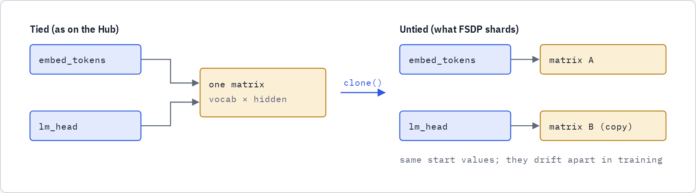

Rank 0 loads the model **tied**. Llama-style checkpoints store only `embed_tokens.weight`; loading untied would leave `lm_head` random and the loss stuck near ln(vocab). If the two names share memory (`data_ptr()` is equal), it clones the matrix into `lm_head` and sets `tie_word_embeddings = False` before saving the seed. Each copy then shards independently.

> **The cost:** one extra `vocab × hidden` matrix. For Qwen2-0.5B that is 151,936 × 896 ≈ 136M parameters, about a fifth of the whole model. The saved checkpoint also no longer matches the Hub's tied layout. Keeping the weights tied under FSDP2 is a possible future improvement.

---

## 11. Precision, autocast and mixed precision

*distributed_utils._load_dtype() · train.py autocast_ctx() · MixedPrecisionPolicy*

bf16 keeps fp32's range but only 8 bits of precision, about 3 significant digits. That is fine for matrix multiplies and too coarse to store weights you are updating:

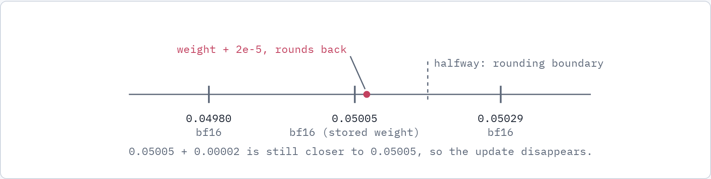

Neighbouring bf16 values near 0.05 are 2⁻¹² ≈ 0.000244 apart. A typical fine-tuning update (lr 2e-5 × a unit-sized Adam step) is 12× smaller than the distance to the rounding boundary.

So trainable weights stay in **fp32**, and only the computation runs in bf16:

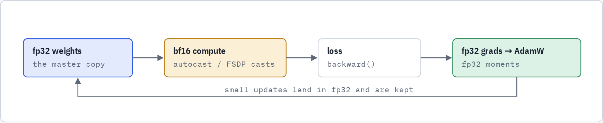

| Strategy | Weights stored as | Compute in bf16 via |
|---|---|---|
| solo / DDP, full fine-tune | fp32 | `torch.autocast(dtype=bf16)` around the forward pass |
| solo / DDP + PEFT | frozen base in bf16, LoRA adapters in fp32 | `torch.autocast` |
| FSDP (with or without PEFT) | fp32 shards | `MixedPrecisionPolicy(param_dtype=bf16, reduce_dtype=fp32)` |
| param_dtype: float16 | fp32 | autocast + `GradScaler` (fp16 can underflow small gradients) |

FSDP2 needs every parameter in a group to share one dtype. That is why FSDP + PEFT keeps the frozen base in fp32 too, instead of mixing bf16 and fp32.

---

## 12. PEFT and LoRA

*distributed_utils._apply_peft_quantization() · peft.get_peft_model()*

**LoRA** freezes each original weight `W` and learns a small correction `B·A` next to it. Here `A` is `r × d`, `B` is `d × r`, and the rank `r` is tiny (8 in the default config). `B` starts at zero, so training begins from exactly the pretrained model.

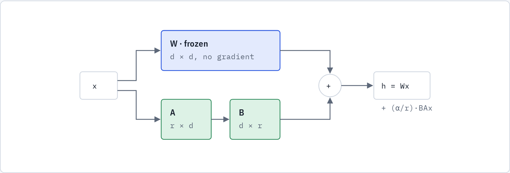

The OPT-125m LoRA run in this repo trains 1,327,104 of 126,566,400 parameters (1.05%). Gradients and Adam state exist only for that 1%.

- `target_modules: all-linear` attaches adapters to every linear layer. A list such as `[q_proj, v_proj]` limits them.
- `trainable_params = [p for p in model.parameters() if p.requires_grad]` is what goes to AdamW, so frozen weights get no optimizer state.
- Under FSDP, adapters are attached **before** sharding, so the model is materialized on CPU first (path 2). Meta init can't be used here.

---

## 13. Quantization (bitsandbytes)

*distributed_utils._build_quantization_config() · prepare_model_for_kbit_training()*

Quantization stores the frozen base weights in fewer bits. **8-bit** uses LLM.int8(); **4-bit** uses NF4, a 4-bit format whose levels are spaced to match normally distributed weights. Weights are unpacked to `compute_dtype` (bf16) just in time for each matmul.

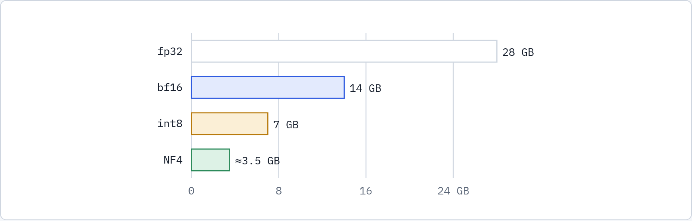

Weight storage for a 7B-parameter model, drawn to scale (NF4 adds a small overhead for its quantization constants). This is what lets a 7B QLoRA run fit on a single consumer GPU.

- **QLoRA** = 4-bit (or 8-bit) frozen base + LoRA adapters in higher precision. `peft.type: qlora` turns on both.
- `prepare_model_for_kbit_training()` upcasts norms to fp32 and enables gradient checkpointing before the adapters attach.
- bitsandbytes stores packed integers plus per-block constants. FSDP's dim-0 sharding can't split that, which is why `fsdp` + quantization is rejected. Use `ddp` or `solo`.

---

## 14. Data, padding and labels

*data.get_dataloader() · _vlm_collate() · _detection_collate() · _rank0_first()*

Every sequence in a batch needs the same length, so short ones are filled with **pad** tokens. The model has to ignore them twice. `attention_mask = 0` hides them from attention, and `label = -100` leaves them out of the loss, because PyTorch's cross-entropy skips `-100`.

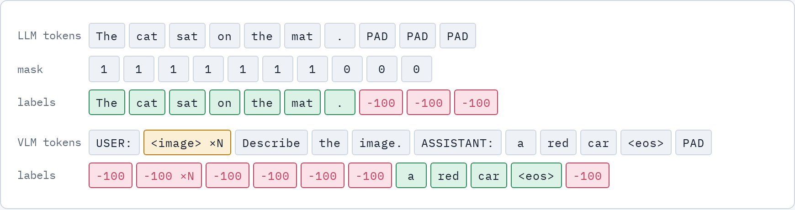

Padding is masked by `attention_mask`, not by the pad token's id. Many tokenizers reuse `<eos>` as the pad token, and masking by id would also hide the real end-of-reply token, so the model would never learn to stop. For VLMs, the prompt is run through the processor on its own to find where the reply starts, which works with either padding side.

- **Text** (`llm`, `seq2seq`, `encoder`): `dataset.map(tokenize)` with `padding="max_length"`.
- **Vision**: the image processor produces `pixel_values` plus an integer label.
- **Detection** and **VLM** use a `collate_fn`, because each image has a variable number of boxes or image tokens, which can't be stacked into one tensor.
- **DistributedSampler** gives each rank a different 1/N of the data. `set_epoch()` reshuffles each epoch, and `drop_last=True` keeps ranks in step.
- **Rank 0 first:** `_rank0_first()` lets rank 0 download and preprocess while the others wait. They then read the finished HF datasets cache instead of all writing to it at once.

---

## 15. The training step

*train.py main()*

```python
for epoch in range(args.epochs):
    sampler.set_epoch(epoch)                       # new shuffle on every rank
    for batch in dataloader:
        optimizer.zero_grad()
        with autocast_ctx():                       # bf16 compute (solo/DDP)
            loss = model(**batch).loss
        scaler.scale(loss).backward()              # DDP all-reduce / FSDP reduce-scatter here
        scaler.unscale_(optimizer)
        clip_grad_norm_(model.parameters(), args.grad_clip)
        scaler.step(optimizer); scaler.update()    # plain step unless fp16
        scheduler.step()                           # warmup, then cosine decay
```

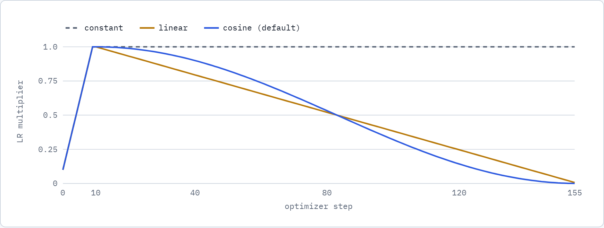

The LR multiplier from `_lr_lambda` for a 156-step run with `warmup_steps: 10`. The rate ramps up linearly, then decays to zero by the last step (cosine or linear), or holds (constant). Multiply by `learning_rate` to get the actual rate.

**Gradient clipping** rescales the whole gradient when its norm exceeds `grad_clip`, so one bad batch can't throw the weights off. With fp16, `unscale_` runs first so the clip sees the true gradient. **Gradient checkpointing** saves memory by recomputing activations during backward instead of storing them, at roughly 33% extra compute.

---

## 16. The Checkpointer

*checkpoint.py · distributed_utils.save_checkpoint()*

Solo and DDP save one `state_dict()` file. FSDP weights are split across ranks, so the `Checkpointer` has to gather a full copy before saving, and split it again on load. It offers two APIs:

- **DCP API (`dcp_api`).** `get_model_state_dict(full_state_dict=True, cpu_offload=True)` gathers the full model. On load, rank 0 reads the file and `broadcast_from_rank0` sends each rank its slice, so only rank 0 needs the full model in RAM.
- **DTensor API (`dtensor_api`).** Saving calls `full_tensor()` on each DTensor. On load, every rank reads the file and `distribute_tensor()` cuts out its own slice. Simpler, but every rank holds the full file in memory.

```text
checkpoints/
├── solo/1760772153123.pt                 # <unix ms>[__tag].pt
├── ddp/1760772159876__lora.pt
└── fsdp/
    ├── dcp_api/
    │   └── 1760772201456__lora/          # run tag: __lora, __qlora_q4, …
    │       ├── model_state_dict.pt
    │       └── optim_state_dict.pt
    └── dtensor_api/1760772299001/…
└── pretrained_seed/…                     # temporary; deleted once loaded
```

- Folder names start with a Unix-millisecond timestamp. `get_latest_checkpoint_folder()` picks the largest.
- The tag records the run mode. Resuming a PEFT run from a non-PEFT checkpoint, or the reverse, fails fast with a clear message (`_check_checkpoint_peft_compat()`).
- FSDP saves optimizer state too, and `resume: true` restores it. Solo and DDP currently save weights only.

---

## 17. Web UI and job queue

*ui/app.py · ui/queue.py · ui/config_adapter.py*

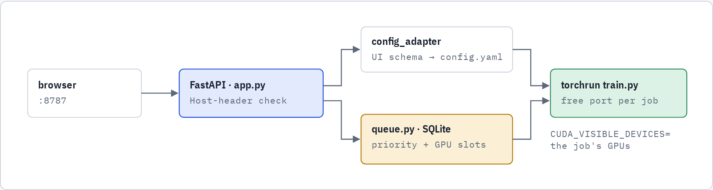

- The UI has its own config schema. `config_adapter` converts it into the format `build_args` expects before any launch.
- Queued jobs wait in SQLite (`ui/queue.db`) until enough GPUs are free. Each job gets its own config file, its own GPUs through `CUDA_VISIBLE_DEVICES`, and its own master port. ddp/fsdp jobs always go through torchrun, even on one GPU.
- The server only answers requests addressed to `localhost`, an IP address or this machine's hostname, plus names in `OMNI_UI_ALLOWED_HOSTS`. This blocks DNS-rebinding pages from reading `/api/env` secrets or starting jobs.

---

## 18. dist_kit: the portable core

*dist_kit/*

`dist_kit` is the distributed core of OMNI-Train in one folder, without the UI or the vision, detection and VLM pipelines. Copy it into another project to get solo, DDP and FSDP2 training with LoRA/QLoRA and checkpointing. It reads the same config schema, and carries the same precision, buffer and seed fixes as the main code.

| dist_kit file | Comes from | Holds |
|---|---|---|
| `config.py` | `utils.build_args` | `DistConfig` dataclass + validation |
| `dist_setup.py` | `distributed_utils` | process group, barriers, rank-aware printing |
| `strategies.py` | `distributed_utils` | `apply_solo/ddp/fsdp`, meta init, buffers, PEFT |
| `checkpoint.py` | `checkpoint.py` | `Checkpointer` (DCP and DTensor) |
| `data.py` | `data.py` | text-only dataloader with label masking |
| `train.py` | `train.py` | minimal reference loop with autocast and LR schedule |

```bash
bash dist_kit/launch.sh              # reads strategy + num_gpus, picks python or torchrun
python -m dist_kit                   # solo
torchrun --nproc_per_node=2 -m dist_kit.train
# config lookup order: $DIST_CONFIG → ./config.yaml → dist_kit/config.yaml
```

---

## 19. Glossary

| Term | Meaning |
|---|---|
| **all-reduce** | every rank contributes a tensor; every rank receives the sum (DDP gradients) |
| **all-gather** | every rank contributes a slice; every rank receives the whole (FSDP before compute) |
| **reduce-scatter** | sum across ranks, each rank keeps one slice (FSDP gradients) |
| **DTensor** | a tensor that knows how it is split across a device mesh, e.g. `Shard(0)` |
| **meta device** | tensors with shape and dtype but no storage |
| **non-persistent buffer** | module state not saved in `state_dict()`, e.g. RoPE `inv_freq` |
| **autocast** | runs selected ops (matmuls) in bf16/fp16 while weights stay fp32 |
| **GradScaler** | multiplies the loss before backward so fp16 gradients don't underflow |
| **LoRA rank r** | inner size of the adapter matrices; trainable params grow linearly with r |
| **NF4** | 4-bit format with levels placed for normally distributed weights |
| **-100** | the label value cross-entropy ignores (padding, prompts, image tokens) |
| **barrier** | every rank waits here until all ranks arrive |

---

*Written against the omni-train repository after commit 74e79c1 (October 2026). File and function names match the code; the charts are computed from the formulas the code uses.*
